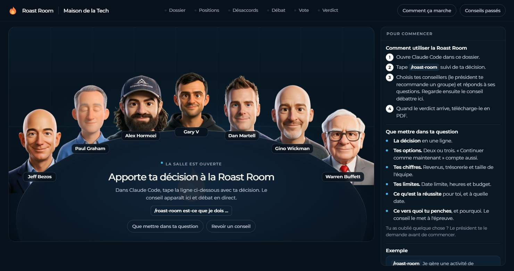

# Roast Room par Maison de la Tech



Tu as une décision difficile à prendre pour ton business ? Un conseil de conseillers IA en débat, puis te donne un verdict noté et un rapport PDF. Douze conseillers sont inclus. Chacun est construit à partir du travail public d'une personne : ses lettres, ses textes, ses conférences et ses vidéos. Le débat se passe dans Claude Code, et une petite application web te montre les conseillers autour d'une table.

L'interface, le rapport PDF et les conseils sont en français.

**Les conseillers sont simulés.** Ce ne sont pas les vraies personnes. Ils ne parlent pas en leur nom, et aucune d'elles n'a validé ce projet. Leurs réponses ne remplacent pas un avocat, un comptable ou un conseiller financier.

## Les conseillers

| Conseiller | Domaine | Sa question |
|---|---|---|
| Jeff Bezos | Stratégie et décisions | Est-ce le bon pari, et peut-on revenir en arrière ? |
| Paul Graham | Produit et startups | Les gens veulent-ils vraiment ça, et est-ce que ça grandit ? |
| Alex Hormozi | Offres, prix et vente | Les gens vont-ils payer, combien, et comment conclure ? |
| Gary Vaynerchuk | Marketing et attention | D'où vient l'attention ? |
| Dan Martell | Équipe, recrutement et temps du fondateur | Qui fait ça, et combien de temps ça te coûte ? |
| Gino Wickman | Organisation et croissance | L'entreprise peut-elle tourner sans toi ? |
| Warren Buffett | Argent et capital | Quel effet sur ta trésorerie, ton risque et ta valeur à long terme ? |

Ces sept conseillers forment le **conseil par défaut**. Cinq autres sont disponibles, et le président les propose quand ta question touche leur domaine :

| Conseiller | Domaine | Sa question |
|---|---|---|
| Naval Ravikant | Effet de levier et richesse | Est-ce que ça construit quelque chose qui t'appartient, ou tu loues juste ton temps ? |
| Codie Sanchez | Acheter et posséder de petites entreprises | Faut-il construire, ou acheter quelque chose qui marche déjà ? |
| Leila Hormozi | Leadership et équipes | Ton équipe peut-elle porter ce projet, et qui doit changer ? |
| Sara Blakely | Produit grand public et marque à partir de zéro | Les clients vont-ils l'aimer assez pour le vendre à ta place ? |
| Elon Musk | Raisonner à partir de zéro et vitesse d'exécution | Quel est le vrai blocage, et peut-on aller plus vite ? |

## Ce qu'il te faut

- [Claude Code](https://claude.com/claude-code). Ton forfait Claude suffit, pas besoin de clé API.
- [Node.js](https://nodejs.org) version 20 ou plus, pour la salle. Rien d'autre à installer.
- [Git](https://git-scm.com) pour télécharger l'outil. Sinon, sur GitHub, clique sur **Code**, puis **Download ZIP**.

## Installation

```bash
git clone https://github.com/MaisonDeLaTech/roast-room-fr.git
cd roast-room-fr
```

Tu peux aussi ouvrir Claude Code et écrire : « Clone github.com/MaisonDeLaTech/roast-room-fr et lance la salle. »

## Lancer un conseil

1. Lance la salle : `npm start`, puis ouvre http://localhost:4730. Laisse-la ouverte.
2. Ouvre Claude Code dans le même dossier : `claude`
3. Tape `/roast-room`, puis ta décision.
4. Réponds aux questions du président, puis regarde les conseillers débattre dans la salle.
5. À la fin, clique sur **Télécharger le PDF**.

Le verdict court s'affiche aussi dans Claude Code. Le rapport complet est dans `sessions/<date>-<décision>/verdict.md`.

**Attention à ton forfait.** Un conseil complet lance trois tours par conseiller, soit 21 agents pour sept conseillers. Il consomme une bonne part de ton forfait. Pour une petite décision, utilise `--quick`.

## Quoi mettre dans ta question

Le conseil vaut ce que tu lui donnes. Indique :

- **La décision**, en une ligne.
- **Tes options.** Deux ou trois. « Continuer comme maintenant » compte.
- **Tes chiffres.** Revenus, épargne, taille de l'équipe.
- **Tes limites.** Date limite, heures disponibles, budget.
- **Ce que serait une réussite**, et pour quand.
- **Ce vers quoi tu penches**, et pourquoi. Le conseil teste ton idée au lieu de l'approuver.

Si tu oublies quelque chose, le président te le demande avant de commencer. Exemple :

```
/roast-room Je vends du coaching : 30 000 € par mois, 15 clients à 2 000 € chacun.
Dois-je passer à 3 500 € pour tout le monde, seulement pour les nouveaux clients, ou rester à 2 000 € ?
Je signe environ un prospect sur deux et j'ai 40 000 € en banque. L'objectif est 45 000 € par mois d'ici mars.
Je penche pour une hausse pour tout le monde, car je me sens sous-payé.
```

Autres façons de l'utiliser :

- `/roast-room --quick ...` : quatre conseillers et deux tours. Pour les petites décisions.
- `/roast-room --seats hormozi,buffett ...` : seulement les conseillers que tu nommes.
- `/roast-room ask hormozi ...` : une seule réponse, d'un seul conseiller.
- `/roast-room --all ...` : tous tes conseillers, neuf au maximum.
- `/roast-room board` : montre le conseil par défaut et te permet de le changer.

La salle est facultative. Le conseil se déroule de la même façon dans Claude Code sans elle.

## Choisir qui s'assoit à la table

Quand tu lances `/roast-room`, le président lit ta question et propose des conseillers, avec une ligne pour expliquer chaque choix. Tu choisis ensuite :

- **Conseil recommandé** : les cinq à sept conseillers choisis pour cette question.
- **Conseil par défaut** : tes sept conseillers habituels.
- **Tout le monde** : tous, si tu en as neuf ou moins.
- **Autre** : écris ton changement, par exemple « garde cette liste, mais ajoute Naval et retire Wickman ».

Chaque conseil garde un conseiller qui surveille les risques, et un autre qui a de bonnes chances de ne pas être d'accord.

Tape `/roast-room board` et dis ce que tu veux : « mets Naval dans mon conseil par défaut », « retire Gary V », ou « arrête de me demander, utilise mon conseil par défaut ».

## Ajouter ton propre conseiller

```
/newroaster Morgan Housel
```

Claude construit le nouveau conseiller de la même façon que les autres : il pose quelques questions, trouve son travail public, le télécharge dans `build/<nom>/`, extrait sa façon de penser, vérifie chaque citation, puis l'ajoute à la liste.

| Niveau | Sources | Pour quoi |
|---|---|---|
| `--quick` | 12 à 20 | Faire un essai |
| par défaut | 30 à 50 | Un conseiller que tu vas utiliser |
| `--deep` | 80 ou plus | Le niveau des sept premiers |

Cette construction consomme une vraie part de ton forfait. Ouvre ensuite une nouvelle session Claude Code pour que le conseiller soit chargé.

Tu peux créer un conseiller à partir d'une personnalité publique avec un vrai travail public, ou à partir de tes propres textes, si tu veux te mettre à la table ou y mettre un mentor qui est d'accord. Les sources brutes restent sur ta machine.

Son portrait de dessin animé demande une clé [kie.ai](https://kie.ai/api-key) dans `.env` (`KIE_AI_API_KEY=`, service payant, environ 5 images par conseiller) et Python avec `opencv-python`. Sans clé, le conseiller marche quand même, avec un visage provisoire.

## Voir un exemple d'abord

Lance `npm start`, ouvre http://localhost:4730, puis clique sur **Conseils passés**. Quatre conseils terminés sont inclus :

- Le cas de Babi, une personne fictive qui se demande si elle doit quitter son CDI, en français.
- Trois autres exemples, en anglais.

## Comment ça marche

- **Le conseil se déroule dans Claude Code.** Chaque conseiller est un agent qui lit son « cerveau » : ses méthodes, ses principes, ses positions, ses histoires et sa façon de parler, chaque citation étant reliée à une source. Claude joue le président : il organise les tours, garde les notes et écrit le verdict.
- **Chaque conseiller note chaque option.** La note compte plus quand la question touche son domaine. Le président limite le verdict si un conseiller signale un risque de ruine, et il force un vrai débat si tout le monde tombe d'accord trop vite.
- **La salle ne fait que regarder.** Le président écrit chaque étape dans `sessions/`, et l'application les rejoue. Elle ne fait aucun appel à une IA.
- **Chaque conseil est gardé** dans `sessions/`, sur ta machine. Ce dossier n'est pas envoyé sur GitHub, sauf les exemples.

## Facultatif : lancer le conseil depuis la salle

Si tu préfères écrire ta décision directement dans la salle, copie `.env.example` vers `.env`, ajoute une clé `ANTHROPIC_API_KEY`, mets `COUNCIL_RUNNER=api`, puis relance `npm start`. Ce mode est facturé sur ton compte API Anthropic, environ 25 appels par conseil complet.

## À propos des conseillers

Les conseillers sont des simulations construites à partir du travail public de chaque personne, comme tout conseiller que tu ajoutes. Ce ne sont pas ces personnes. Ils ne parlent pas en leur nom, et aucune d'elles n'est liée à ce projet ni ne le soutient. Un conseiller ne cite une personne mot pour mot que si la phrase est dans son cerveau avec sa source, et `python .claude/skills/roast-room/scripts/check_quotes.py sessions/<session>` vérifie toutes les citations d'un conseil. Le fichier `sources.md` de chaque cerveau liste ce qui a servi à le construire.

## Crédits et licence

Le code est sous licence MIT, voir `LICENSE`. Le générateur de PDF inclut [jsPDF](https://github.com/parallax/jsPDF) (MIT) et [Montserrat](https://github.com/JulietaUla/Montserrat) (SIL Open Font License) ; leurs licences se trouvent dans `app/public/`.
